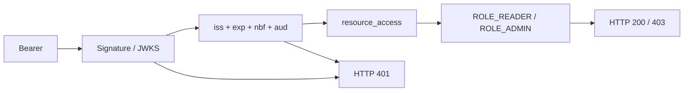

# Parcours : frontières JWT et Keycloak

[English version](README.md)

Un parcours de six chapitres, avec 18 exercices corrigés et un laboratoire Java vérifié. Public : développeurs Spring et ingénieurs qui doivent expliquer un refus d’accès, pas seulement décoder un JWT.

## Point de départ

Le [laboratoire autonome](https://github.com/jihedbfr-art/spring-keycloak-toolkit/tree/9e7fd6ed18a40588400e167424e85753d38ad406/examples/resource-server) est fixé au commit `9e7fd6ed18a40588400e167424e85753d38ad406`. Il fournit 19 tests HTTP et six contrôles du JAR. Les exemples sont synthétiques. JDK, Maven, Docker/Compose et Python sont détaillés dans son guide. Depuis un clone de ce dépôt à cette révision :

```bash
mvn clean install
mvn -f examples/resource-server/pom.xml clean verify
```



## Chapitres

| Chapitre | Question |
|---|---|
| [Signature et émetteur](01-signature-issuer/README.fr.md) | La clé et l’émetteur sont-ils approuvés ? |
| [L’audience est une frontière distincte](02-audience/README.fr.md) | Le jeton vise-t-il cette API ? |
| [Rôles clients et mapping des autorités](03-role-boundaries/README.fr.md) | Quels rôles deviennent des autorités ? |
| [Diagnostiquer 401 et 403](04-http-errors/README.fr.md) | Où chercher derrière 401 et 403 ? |
| [Identités de comptes de service](05-service-accounts/README.fr.md) | Qui agit avec client_credentials ? |
| [Preuves et reproduction maîtrisée](06-evidence/README.fr.md) | Que prouve chaque niveau de test ? |

## Méthode

Avant de lancer une commande, noter le résultat attendu et la frontière contrôlée. Après exécution, relever statut, nom du test et commande, sans copier de jeton. Consulter ensuite les corrections des trois exercices du chapitre. Une réponse au quiz ne remplace pas l’exécution du test.

Les 14 tests de JWT locaux isolent les claims et signatures ; les cinq tests Keycloak ajoutent l’émission réelle. Les six contrôles du JAR ajoutent le packaging. La validation locale de référence a réussi sur Windows/JDK 17 avec Spring Boot 4.1.0 et Keycloak 26.7.2. La CI Java 17/21 du laboratoire doit être relue sur son commit courant ; ce parcours ne transforme pas un résultat ancien en garantie actuelle.

## Limites

Pas de données opérateur, de compte réel ou de test de production. Les valeurs de credentials sont publiques et réservées au realm de démonstration. Rotation JWKS, révocation immédiate, navigateur/PKCE, MFA, tenants et transport MCP ne sont pas couverts. Ne pas présenter la validation d’un de ces niveaux comme la preuve des autres.

Pour les cas existants de la bibliothèque : [claims de rôles malformés](../../debugging-recipes/keycloak-role-claims/README.fr.md), [readiness Keycloak](../../debugging-recipes/keycloak-readiness/README.fr.md), [contexte de sécurité MCP](../../debugging-recipes/mcp-tool-security-context.fr.md).

---

<div align="center">
  
  <br>
  <sub>Un projet <a href="https://github.com/jihedbfr-art"><b>JihedAiLabs</b></a></sub>
</div>
