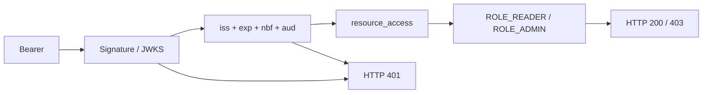

# Course: JWT and Keycloak boundaries

[Version française](README.fr.md)

Six chapters, 18 worked exercises and a verified Java lab. For Spring developers and engineers who need to explain an access rejection, beyond decoding a JWT.

## Starting point

The [standalone lab](https://github.com/jihedbfr-art/spring-keycloak-toolkit/tree/dc2e74e12dafbc337ea94848694fec1bbf1631b6/examples/resource-server) is pinned to commit `dc2e74e12dafbc337ea94848694fec1bbf1631b6`. It provides 19 HTTP tests and six packaged checks. Inputs are synthetic. Its guide specifies JDK, Maven, Docker/Compose and Python prerequisites. From that repository checkout at this revision:

```bash
mvn clean install
mvn -f examples/resource-server/pom.xml clean verify
```



## Chapters

| Chapter | Question |
|---|---|
| [Signature and issuer](01-signature-issuer/README.md) | Are the key and issuer trusted? |
| [Audience is a separate boundary](02-audience/README.md) | Is this API the intended recipient? |
| [Client roles and authority mapping](03-role-boundaries/README.md) | Which roles become authorities? |
| [Diagnose 401 and 403](04-http-errors/README.md) | Where should 401 and 403 be diagnosed? |
| [Service-account identities](05-service-accounts/README.md) | Who acts with client_credentials? |
| [Evidence and safe reproduction](06-evidence/README.md) | What does each evidence level establish? |

## Method

Before running a command, write down the expected result and the boundary under test. Afterwards, record the status, test name and command, without copying a token. Then open the three worked answers in that chapter. A quiz answer does not replace running the test.

Fourteen local JWT tests isolate claims and signatures; five Keycloak tests add real issuance. Six JAR checks add packaging. The reference local validation passed on Windows/JDK 17 with Spring Boot 4.1.0 and Keycloak 26.7.2. Check the lab's Java 17/21 CI at its current commit; this course does not turn an older result into a current guarantee.

## Limits

No operator data, real accounts or production tests. Credential values are public and restricted to the demonstration realm. JWKS rotation, immediate revocation, browser/PKCE, MFA, tenants and MCP transport are not covered. Evidence at one level is not evidence at all the others.

Related library cases: [malformed role claims](../../debugging-recipes/keycloak-role-claims/README.md), [Keycloak readiness](../../debugging-recipes/keycloak-readiness/README.md), [MCP security context](../../debugging-recipes/mcp-tool-security-context.md).

---

<div align="center">
  
  <br>
  <sub>A <a href="https://github.com/jihedbfr-art"><b>JihedAiLabs</b></a> project</sub>
</div>
